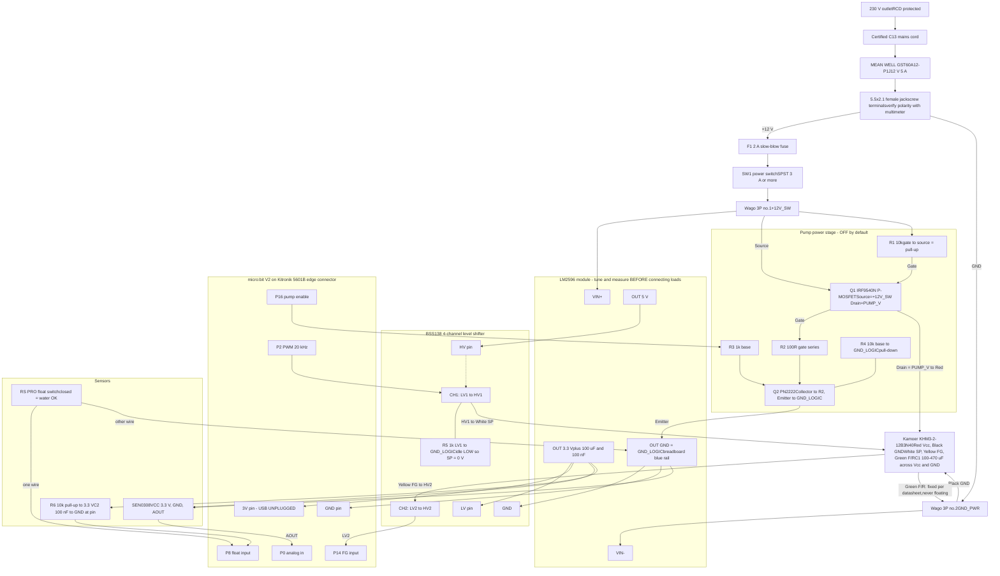
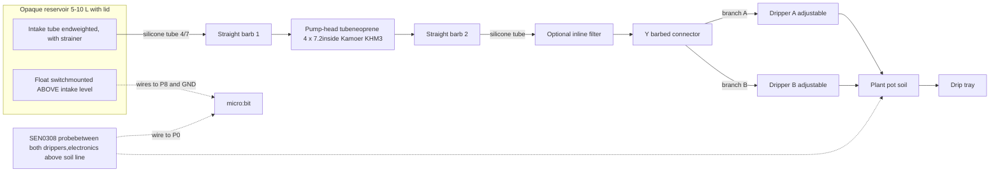

# Automatic watering system – diagrams

Zoom 1500 px

Scroll inside each diagram to pan. Use the slider to enlarge it. To save as PNG/SVG, paste the Mermaid code into mermaid.live and use Actions → Download.

## A. Power distribution and signal wiring

## B. Hydraulics: one reservoir, one plant, two drippers

